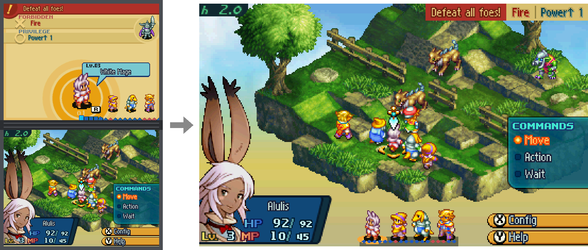
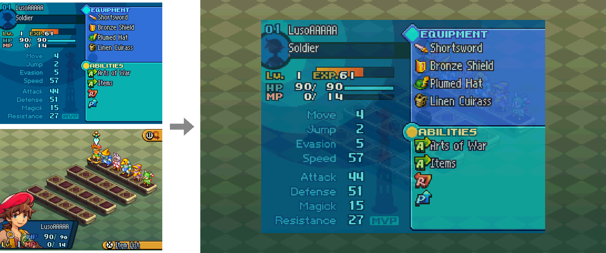
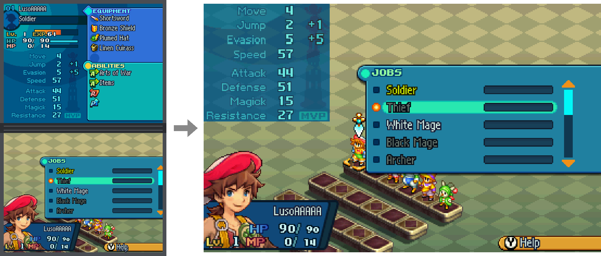
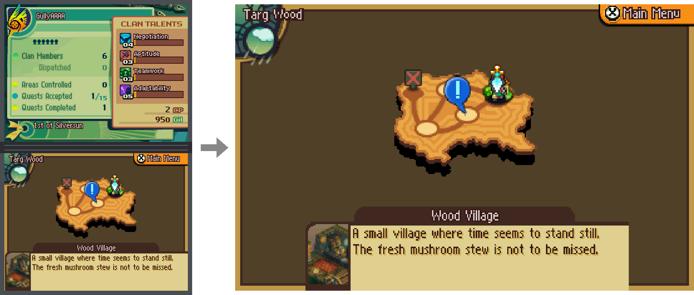
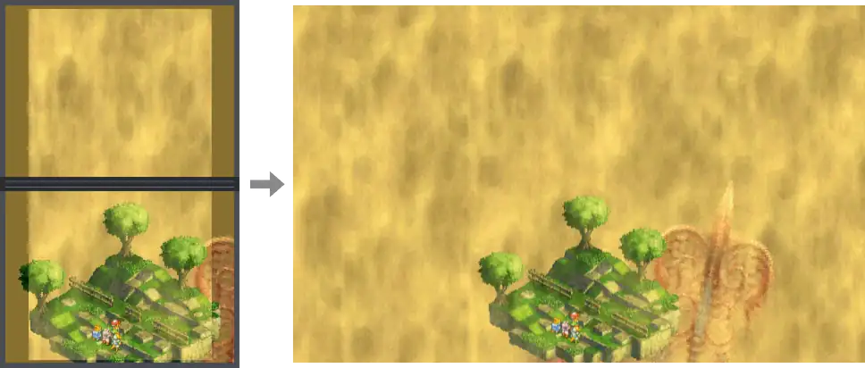

# FFTA2 One Screen

A patch for *Final Fantasy Tactics A2: Grimoire of the Rift* (Nintendo DS, US version) that puts
the whole game on one screen, for playing in an emulator on a Steam Deck, a PC monitor or a
phone.



*Left: the game as the DS shows it, on two screens. Right: the same moment with this mod, on
one 1280x800 screen (the Steam Deck patch).*

## Why

The DS splits the game over two screens: you play on the bottom one, and the top one shows the
battle's objective, the law, the turn order and the details of whatever you're looking at. An
emulator has to show those as two small pictures side by side, stacked, or with one in a
corner, so you never see the game big. This mod puts everything on the gameplay screen and
widens it to fill a modern display.

## What it does

**Battles fill the screen.** The battle map, the backdrop and the game's panels reach out to the
edges of a wide screen. On the Deck you see about 14% more of the scene each way than on the DS.
The top screen's essentials move into a **banner** at the top right (the objective, the law and
the clan privilege), and the **turn order** sits at the bottom centre. Hold SELECT to hide or
show the banner.

**Tap SELECT to see the top screen's page.** In battle it swaps in at full size. In menus it
drops over the menu as a see-through sheet, so you can check a unit's equipment and abilities
without leaving the list:



**Menus show what matters next to the list.** Where the top screen held information you need
while choosing, the mod shows it beside the list instead. In Change Jobs, the stat changes of
the highlighted job sit at the top left:



**Everything else is widened too.** The world map, towns, shops, the bazaar, auctions, story
scenes and the title screen all fill the wide screen.



**The Scions' summons play whole.** They are the only animations the game draws across both
screens at once. With the mod they play as one tall picture on the one screen:



*Pictures: left, the unmodified game on the DS's two screens (2x); right, the Steam Deck patch
at 1280x800. Each pair comes from the same savestate.*

**See more:** [the before-and-after catalogue](docs/catalogue.md) has 33 more pairs, from
battles and menus to towns, shops and the late game.

It is made for emulators. Real DS hardware is not supported.

## How to use

You set it up once: patch your ROM, then set the emulator to show only the bottom screen,
stretched. **[docs/setup-guide.md](docs/setup-guide.md)** has every step in detail, including the
Steam Deck in Game Mode, EmuDeck, and other emulators on PC and phones.

### 1. Check your ROM

You need your own dump of the US cartridge, *Final Fantasy Tactics A2: Grimoire of the Rift*
(game code `A6FE`). European and Japanese versions won't work, and neither will trimmed ROMs.
It must match exactly:

| | |
| --- | --- |
| Size | 134,217,728 bytes (128 MiB) |
| CRC32 | `5826b0b0` |
| SHA-1 | `7ec7646c527be6af87e3c7ab0ed454f952842001` |

### 2. Download the patch for your screen

From the [Releases page](https://github.com/leo-courant/FFTA2-One-Screen/releases), take the
file that matches the shape of your display. The shape is fixed when you patch and can't be
changed in the game afterwards.

| File | For |
| --- | --- |
| `ffta2-1screen-deck.bps` | Steam Deck and other 16:10 screens (1280x800, 1920x1200…) |
| `ffta2-1screen-16x9.bps` | 16:9 monitors, TVs and laptops (1920x1080 and up) |
| `ffta2-1screen-4x3.bps` | the game's own 4:3 picture, for emulators that can't stretch one screen; you still get the banner, turn order and SELECT page |
| `ffta2-1screen-patcher.py` | ROMs that already carry another mod (see [With other mods](#with-other-mods)) |

### 3. Patch

Apply the `.bps` file to your ROM with any BPS patcher:
[Rom Patcher JS](https://www.marcrobledo.com/RomPatcher.js/) runs in the browser (phones too),
and Flips is a common one on PC. If the patcher reports a checksum mismatch, your ROM isn't the
clean US dump, and the result won't work. Keep your original ROM for updates.

### 4. Set up the emulator

melonDS 1.1 is the tested emulator. The settings that matter:

| Where | Setting | Value |
| --- | --- | --- |
| Config → Video settings | 3D renderer | OpenGL (Classic) |
| Config → Video settings | Internal resolution | 8x (9x for the `16x9` patch) |
| Config → Video settings | Improved polygon splitting | on |
| View → Screen sizing | | Bottom only |
| View → Aspect ratio → Bottom | | Window |
| View | Force integer scaling | off |
| View | Screen filtering | off |

Play in fullscreen (`melonDS -f your-rom.nds`, or the "Toggle fullscreen" hotkey); otherwise the
menu bar takes a strip of the screen. Put SELECT on a button that is easy to hold: on the Steam
Deck a back button (L4 or R4) works well. Other emulators need the same four things (high
resolution 3D, bottom screen only, stretched to fill, SELECT on a button); the
[setup guide](docs/setup-guide.md#other-emulators-pc-and-phones) lists settings for each.

### 5. Play

You play with the game's normal buttons. The mod adds two actions on SELECT:

| Do this | In battle | In menus (shops, party, equipment, world map) |
| --- | --- | --- |
| **Tap SELECT** | Shows the game's top screen full size; tap again to return | Lays the top screen's page over the menu as a see-through sheet; the D-pad keeps it up, A, B, X, Y or START close it |
| **Hold SELECT** (half a second) | Turns the banner and turn order off or back on | Same |

- A tap counts when you let go of SELECT. SELECT pressed together with another button does
  nothing in the mod, so emulator hotkeys that use SELECT are safe.
- The game's soft reset (L + R + START + SELECT) still works.
- Use the buttons rather than touch: touch isn't adjusted for the wider picture.
- **Saves:** in-game saves work as usual (the save file is named after the ROM, so to bring an
  old save across, give it the patched ROM's name). Emulator savestates don't carry over
  between the unpatched game and the mod, or between two patch files.

## With other mods

The `.bps` files only apply to the clean ROM. To combine this mod with another one, use the
patcher script, which needs Python 3 and nothing else:

1. Apply the other mod to your clean ROM first, the way that mod says to.
2. Then add this one:

   ```sh
   python3 ffta2-1screen-patcher.py your-modded-ffta2.nds ffta2-1screen.nds --display deck
   ```

The patcher checks only the places in the game code this mod changes. If the other mod changed
one of them too, the patcher lists them and writes nothing.

- **Expected to work:** mods that change only the game's data (unit, job, ability or item
  stats). Tested with *Promise Rewritten* 0.9.7 up to the first battle.
- **May clash:** mods that change screens, menus or text, or that add code of their own. Text
  mods can also get cut off: the banner and the ability list were sized for the original texts.
- **Not detectable when patching:** this mod uses 64 KB of the game's main memory (from
  0x02143E20, where the game's heap used to start) and some video memory while the game runs. Another mod that adds code and uses the same memory would break
  in play, not when patching.
- Apply this mod **last**, and only once.

## Building it yourself

The release files are built from this repository with Python 3, `ziglang` and `keystone-engine`
(see [Building for another size](docs/setup-guide.md#building-for-another-size), which also makes
patches for display sizes the release doesn't cover), plus one file that isn't in it: the
extended edges of the map of Ivalice. That art is made from the game's own map picture, so it
stays out of the repository; [docs/adr/0018](docs/adr/0018-map-of-ivalice-edges-are-ai-extended.md)
describes how it is made. A build without it is the same mod, except that the map of Ivalice
shows the game's flat sea at its far left and right. `scripts/make_release.py` builds every
release file, and refuses the release if the map art is missing or if any file contains bytes
of the original game.
How the mod works inside is written up in `docs/adr/`, and `CLAUDE.md` is the guide for working
on the code.

## Legal

- This is an unofficial fan project. It is not affiliated with, endorsed by or connected to
  Square Enix or Nintendo. *Final Fantasy Tactics A2* and all of its content belong to their
  owners.
- You must dump the game from a cartridge you own. This project does not provide ROMs, does not
  link to them, and will not help you find them.
- The patches and the patcher contain only the mod's own code. They don't contain any part of
  the original game: every release is checked for that automatically. The pictures in
  `docs/pictures/` (the original game next to the mod, shown here and in the
  [catalogue](docs/catalogue.md)) are the only game images in the repository.
- The mod's code and documents are under the [MIT License](LICENSE).
